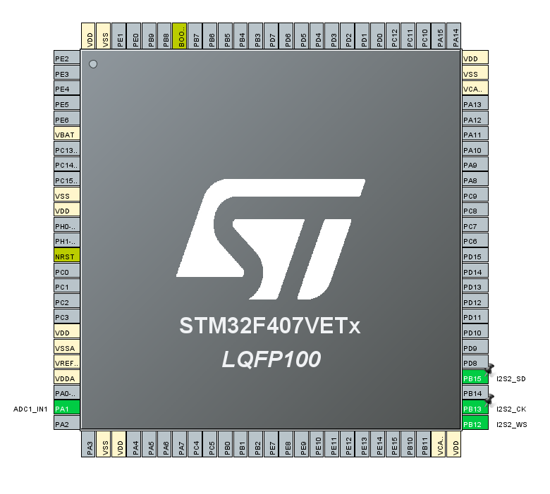
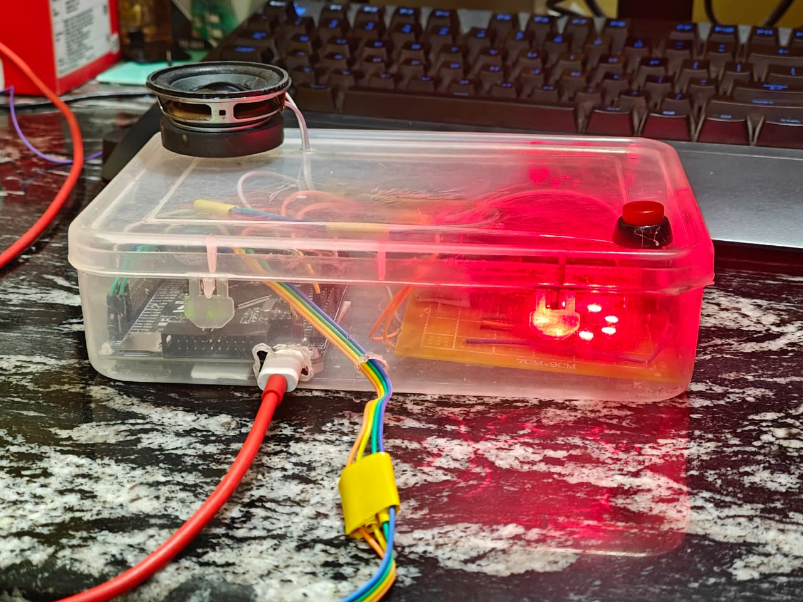
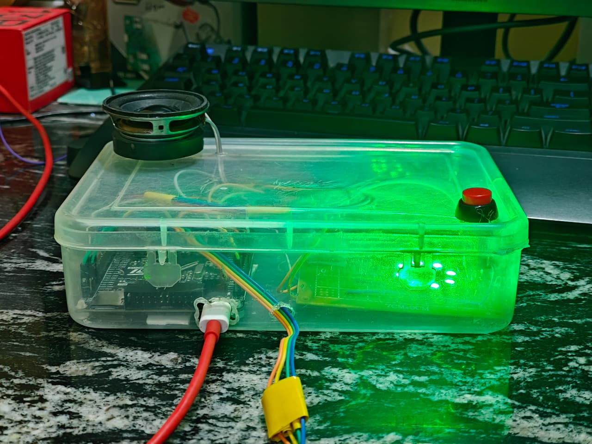
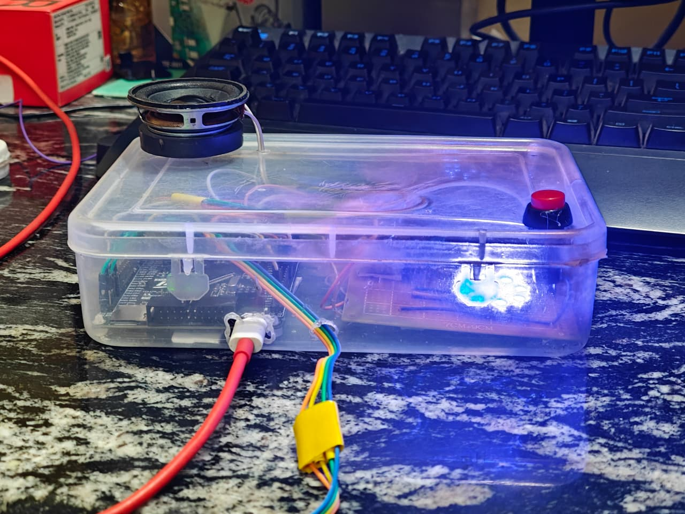
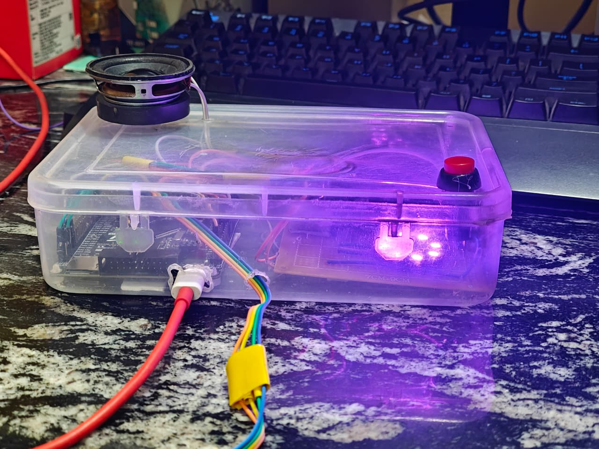
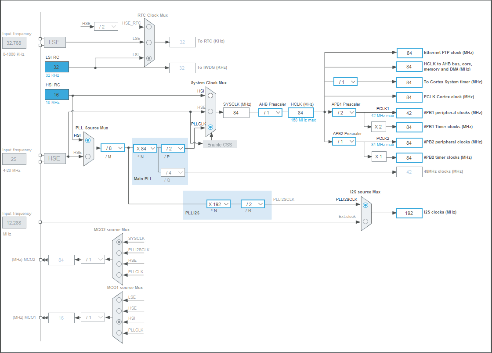

<p align="center">
  
  
  
  
  
</p>

<h1 align="center">🎙️ STM32 Voice Modifier Walkie-Talkie</h1>

<p align="center">
  <b>A bare-metal real-time DSP system that captures, transforms, and plays back voice audio using 4 unique processing modes — all running on an ARM Cortex-M4 microcontroller with zero OS overhead.</b>
</p>

<p align="center">
  
</p>

---

## ✨ What It Does

Hold a button → speak into the mic → release → hear your voice played back through a speaker with real-time DSP effects applied. A WS2812B LED ring shows which mode you're in. Short-press cycles through modes; long-hold records.

> **Think of it as a voice-effects pedal, but for a walkie-talkie — built entirely from scratch on bare metal.**

---

## 🎛️ The 4 Voice Modes

| Mode | Name | LED Color | What Happens to Your Voice |
|:----:|------|:---------:|---------------------------|
| **1** | **Raw Voice** | 🔴 Red | Clean passthrough — your voice as captured, with basic noise gating |
| **2** | **Clear Filter** | 🟢 Green | Aggressive noise removal — high-pass/low-pass filtering with amplified gain and a hard noise gate that zeros out ambient sound |
| **3** | **Robot Voice** | 🔵 Blue | Ring modulation — your voice is multiplied by a 40Hz sine wave carrier, destroying natural harmonics for a synthetic mechanical tone |
| **4** | **Canyon Echo** | 🟣 Purple | Time-delay echo — a ~375ms look-back mixes decayed historical audio with the current signal, creating cascading reverb |

<p align="center">
  
  
  
  
</p>
<p align="center"><i>LED indicators for each of the 4 processing modes</i></p>

---

## 🏗️ Hardware Architecture

```
┌─────────────────────────────────────────────────────────────────────┐
│                        STM32F407VET6                                │
│                     84MHz · 192KB SRAM · FPU                        │
│                                                                     │
│   ┌──────────┐    ┌──────────┐    ┌───────────┐    ┌─────────────┐ │
│   │  PA1/ADC1 │◄───│ MAX9814  │    │ SPI2/I2S  │───►│  MAX98357A  │ │
│   │  (12-bit) │    │ Mic+AGC  │    │ PB12-15   │    │  Class-D    │ │
│   └──────────┘    │ 40dB Gain│    └───────────┘    │  Amplifier  │ │
│                    └──────────┘                      └──────┬──────┘ │
│   ┌──────────┐                                             │        │
│   │  PA0     │◄─── Push Button (Pull-Up)            5W 4Ω Speaker  │
│   │  (Input) │     Short = Mode Cycle                               │
│   └──────────┘     Long  = Record (PTT)                             │
│                                                                     │
│   ┌──────────┐    ┌──────────────┐                                  │
│   │  PA2     │───►│  WS2812B     │                                  │
│   │  (GPIO)  │    │  8-LED Ring  │                                  │
│   └──────────┘    │  NRZ @ DWT   │                                  │
│                    └──────────────┘                                  │
└─────────────────────────────────────────────────────────────────────┘
```

### Components

| Component | Role | Interface | Key Detail |
|-----------|------|-----------|------------|
| **STM32F407VET6** | Main MCU | — | 84MHz Cortex-M4 with hardware FPU |
| **MAX9814** | Electret mic + AGC | ADC1 (PA1) | Gain pin → GND = locked at 40dB |
| **MAX98357A** | I2S DAC + Class-D amp | SPI2/I2S (PB12-15) | Drives a 5W 4Ω speaker |
| **WS2812B** | RGB LED ring (×8) | GPIO (PA2) | Bit-banged via DWT cycle counter |
| **Tactile Button** | Mode select / PTT | GPIO (PA0) | Internal pull-up, software debounced |

<p align="center">
  
</p>
<p align="center"><i>STM32CubeMX pin and peripheral configuration</i></p>

---

## ⚙️ Firmware Design

### State Machine

```
                ┌──────────────┐
                │              │
                │   IDLE       │◄──────── Playback complete
                │              │
                └──────┬───────┘
                       │
                 Long hold (>400ms)
                       │
                       ▼
                ┌──────────────┐
                │              │
                │  RECORDING   │──── Buffer full (3.5s)
                │              │         │
                └──────┬───────┘         │
                       │                 │
                  Button released        │
                       │                 │
                       ▼                 ▼
                ┌──────────────┐
                │              │
                │  PLAYBACK    │
                │              │
                └──────────────┘
```

### Memory Layout

| Resource | Allocation | Purpose |
|----------|-----------|---------|
| **Audio Buffer** | 112 KB (56,000 × `int16_t`) | 3.5 seconds at 16 kHz sample rate |
| **ADC DMA Buffer** | 512 × `uint16_t` | Double-buffered circular ADC capture |
| **I2S DMA Buffer** | 1024 × `uint16_t` | Double-buffered stereo I2S output |

### DSP Pipeline

Every incoming ADC sample passes through this chain before being stored:

```
ADC Sample (12-bit)
    │
    ▼
DC Offset Removal  ──►  IIR tracking: offset = 0.995·prev + 0.005·sample
    │
    ▼
High-Pass Filter   ──►  y[n] = 0.98·y[n-1] + 0.98·(x[n] - x[n-1])
    │
    ▼
Low-Pass Filter    ──►  y[n] = 0.85·x[n] + 0.15·y[n-1]
    │
    ▼
Mode-Specific FX   ──►  Gain / Noise Gate / Ring Mod / Echo
    │
    ▼
Hard Clipping      ──►  Clamp to [-32768, +32767]
    │
    ▼
Store to SRAM Buffer
```

### DMA Architecture

- **ADC → DMA2 Stream0**: Timer3-triggered at 16 kHz, fills `adc_buffer` in circular mode with half/complete transfer callbacks
- **I2S → DMA1 Stream4**: Continuously streams `i2s_buffer` to the MAX98357A DAC

Zero CPU intervention during transfers — processing happens entirely in the DMA callbacks.

---

## 🔧 Interesting Engineering Challenges

### WS2812B Timing on 3.3V at 84MHz

The WS2812B protocol requires precisely timed pulses:
- **Bit "1"**: HIGH for ~800ns, LOW for ~450ns
- **Bit "0"**: HIGH for ~400ns, LOW for ~850ns

Standard `HAL_Delay()` doesn't have nanosecond resolution, and compiler optimizations made `NOP`-based delays unreliable. The solution: **ARM DWT Cycle Counter**.

```c
// Enable the hardware cycle counter at boot
CoreDebug->DEMCR |= CoreDebug_DEMCR_TRCENA_Msk;
DWT->CYCCNT = 0;
DWT->CTRL |= DWT_CTRL_CYCCNTENA_Msk;

// Deterministic nanosecond timing using CPU cycles
GPIOA->BSRR = GPIO_PIN_2;            // Pin HIGH
uint32_t t = DWT->CYCCNT;
while((DWT->CYCCNT - t) < 50);       // ~595ns at 84MHz
GPIOA->BSRR = GPIO_PIN_2 << 16;      // Pin LOW
```

This gives **cycle-accurate timing** independent of compiler optimizations.

---

## 📂 Repository Structure

```
STM32-Voice-Modifier-Walkie-Talkie/
├── firmware/
│   ├── Core/
│   │   ├── Inc/               # Header files (main.h, HAL config, IRQ handlers)
│   │   ├── Src/               # Source files (main.c, HAL MSP, IRQ handlers)
│   │   └── Startup/           # ARM startup assembly
│   ├── Drivers/
│   │   ├── CMSIS/             # ARM CMSIS headers
│   │   └── STM32F4xx_HAL_Driver/  # ST HAL library
│   ├── EWARM/                 # IAR Embedded Workbench project files
│   ├── modetesting.ioc        # STM32CubeMX configuration
│   ├── STM32F407VETX_FLASH.ld # Flash linker script
│   └── STM32F407VETX_RAM.ld   # RAM linker script
├── images/                    # Hardware photos and pinout diagrams
├── docs/
│   ├── project-report.pdf     # Detailed project documentation
│   └── reports.txt            # Technical specification
├── .gitignore
├── LICENSE
└── README.md
```

---

## 🚀 Getting Started

### Prerequisites

- [STM32CubeIDE](https://www.st.com/en/development-tools/stm32cubeide.html) (v1.10+)
- STM32F407VET6 development board
- ST-Link V2 debugger/programmer
- Hardware components listed in the [Hardware Architecture](#-hardware-architecture) section

### Build & Flash

1. **Clone the repository**
   ```bash
   git clone https://github.com/YOUR_USERNAME/STM32-Voice-Modifier-Walkie-Talkie.git
   ```

2. **Open in STM32CubeIDE**
   - `File → Import → Existing Projects into Workspace`
   - Navigate to the `firmware/` directory

3. **Build**
   - `Project → Build All` (or `Ctrl+B`)

4. **Flash to the board**
   - Connect your ST-Link V2
   - `Run → Debug As → STM32 C/C++ Application`

### Usage

| Action | Input | Result |
|--------|-------|--------|
| **Switch mode** | Quick press (<400ms) | Cycles through modes 1→2→3→4→1 |
| **Record** | Hold button (>400ms) | Records up to 3.5 seconds of audio |
| **Play** | Release button | Plays back the processed audio through the speaker |

---

## 📊 Technical Specifications

| Parameter | Value |
|-----------|-------|
| MCU Clock | 84 MHz (PLL from HSI) |
| ADC Resolution | 12-bit |
| Sample Rate | 16 kHz (Timer3 triggered) |
| Audio Format | 16-bit signed PCM, mono capture / stereo output |
| Max Record Time | 3.5 seconds (56,000 samples) |
| Audio Buffer | 112 KB of 192 KB SRAM |
| DMA Channels | 2 (ADC Rx + I2S Tx) |
| LED Protocol | WS2812B NRZ, DWT cycle-accurate timing |
| Power Supply | 3.3V logic level throughout |

---

## 📝 License

This project is licensed under the MIT License — see the [LICENSE](LICENSE) file for details.

---

<p align="center">
  <b>Built with bare-metal C, solder, and a lot of oscilloscope debugging. 🔬</b>
</p>
